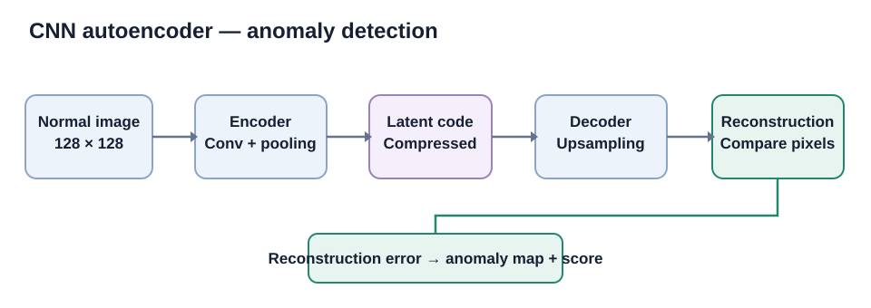

# Manufacturing Quality Inspection with CNN Anomaly Detection

A convolutional autoencoder learns the appearance of defect-free manufactured parts and flags unusual test images using reconstruction error.

## Dataset: MVTec AD

This project is designed for the official **MVTec Anomaly Detection (MVTec AD)** benchmark. The dataset contains more than 5,000 high-resolution images across 15 object and texture categories. It provides defect-free training images, test images with normal and anomalous examples, and pixel-precise anomaly masks. [Official MVTec dataset page](https://www.mvtec.com/research-teaching/datasets/mvtec-ad)

**License:** CC BY-NC-SA 4.0. The dataset is for non-commercial use; review the official terms before use. The image data are not copied into this GitHub repository.



## Problem and approach

In many inspection settings, defect examples are scarce and can vary. This project uses an unsupervised anomaly-detection approach:

1. Train a convolutional autoencoder using only defect-free `train/good` images.
2. Hold out a subset of normal training images to calibrate anomaly thresholds.
3. Reconstruct each test image.
4. Calculate per-pixel reconstruction error and average it into an image-level anomaly score.
5. Evaluate image-level defect detection and pixel-level localization against the provided ground-truth masks.

A high reconstruction error indicates that the image contains patterns unlike the normal training examples. This is a research baseline, not a guarantee that every defect will be detected.

## Dataset setup

Download and extract MVTec AD from the official MVTec page. Select a category (the default is `bottle`) and place the category folder under `data/`:

```text
data/
  bottle/
    train/
      good/
        *.png
    test/
      good/
        *.png
      broken_large/
        *.png
      broken_small/
        *.png
      contamination/
        *.png
    ground_truth/
      broken_large/
        *_mask.png
      broken_small/
        *_mask.png
      contamination/
        *_mask.png
```

The actual defect folder names depend on the selected category. Keep the original MVTec directory names and mask filenames unchanged. The script automatically discovers test defect folders and pairs each image with its ground-truth mask.

## Train and evaluate

Python 3.10–3.12 with a compatible TensorFlow build is recommended.

```bash
pip install -r requirements.txt
python src/train.py --data data --category bottle
```

Optional settings:

```bash
python src/train.py --data data --category cable --epochs 80 --image-size 128 --batch-size 16
```

The training script saves the autoencoder, normal-only calibrated thresholds, image-level and pixel-level metrics, holdout predictions/plots and a qualitative anomaly-map panel under `outputs/`.

## Inference

After training:

```bash
python src/predict.py --input path/to/new_part.png
python src/predict.py --input path/to/inspection_batch/
```

The script writes image-level anomaly scores and good/defect predictions to `outputs/predictions.csv`.

## Evaluation

Image-level metrics:
- Accuracy, precision, recall and F1
- ROC-AUC and average precision
- Confusion matrix

Pixel-level localization metrics:
- Precision, recall and F1 at the calibrated pixel threshold
- Pixel ROC-AUC and average precision
- Qualitative comparison of input image, reconstruction-error map and ground-truth mask

Thresholds are calibrated from a held-out subset of normal training images, not from the test labels. Results apply only to the selected MVTec category and image resolution.

## Current repository status

The code and experiment design are committed. No MVTec image files have been supplied or copied into this repository, so **there are no trained weights or measured performance numbers committed yet**. The training script generates these artifacts when the selected category is available. This is preferable to inventing accuracy or presenting a fabricated training result.

## Limitations

- Reconstruction-based anomaly detection can miss subtle defects or respond to harmless lighting and pose changes.
- A threshold calibrated on one category/camera may not transfer to another.
- MVTec AD is a controlled benchmark and does not replace validation on production-line images.
- The dataset's non-commercial licence must be respected.
- Image-level detection does not by itself prove suitability for safety-critical inspection.

## Skills demonstrated

Python, TensorFlow/Keras, convolutional autoencoders, unsupervised learning, image preprocessing, anomaly detection, pixel-level evaluation and computer-vision visualization.
